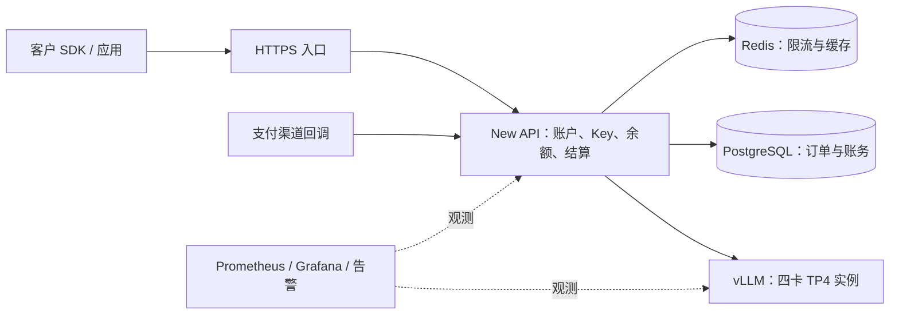

# 4×RTX 5090 部署 Qwen3.8-Flash-Next：方案核验、优化建议与商业实施待审稿

研究核验日期：2026-10-26；漫道云环境与操作边界修订：2026-10-28。范围：Qwen 部署、API 产品、账户充值、计量结算、监控运维、试运营和正式售卖。GLM 留待后续项目。

**交给新 agent 实施时，先读 [执行手册](Qwen四卡部署到售卖_执行手册.md)。** 按用户最新要求：选择四张 5090，官方 vLLM 成功后先完成商业全链路，之后再优化；本长稿作为按需查阅的研究依据。

**状态：研究与实施参考，不是已经通过 Qwen 实机验收的最终配置。** 2026-10-26 的研究读取了上游资料、评论、配置与源码，查询了镜像 Registry，并读取了权重文件头。已读取更新至 2026-10-28 的[漫道云环境记录](漫道云部署环境核实记录与后续部署参考.md)及其链接的只读响应，已知节点 node01、集群 5090、参考服务/存储与仓库信息；用户后续会自行关闭 Gemma，按此前安排分配其中四张 5090 给 Qwen。**用户没有 kubeconfig，不能随意操作其他应用、容器或镜像；当前可用的查询通道不等于平台写操作授权。** 尚未执行目标 Qwen 四卡推理或性能测试，也未在本次文档修订中停止 Gemma。原方案、Gemini 补充、旧 Codex 草案及 PEDIA 建议仍只作为研究线索。

阅读顺序：四组链接看第 3 节；QWEN-PEDIA 与 Gemini 的比较看第 4 节，新增 Gemini 建议的逐条核验看 4.5，新发现的 FP4-Local 候选看 4.6；豆包技术栈看第 5 节；完整实施与商业闭环看第 7–16 节。

### 本次环境核对结论

**默认流程改为“网页新建自己应用＋只读接口复核＋自己 Pod 网页终端验收”，全程不依赖 kubeconfig 或 kubectl。** 保留固定官方 vLLM＋NVIDIA NVFP4 的首轮路线；Gemma 停服由用户之后完成，后端跑通后继续 New API、计费、支付、监控和压测，LiteLLM 后置。

| 最新证据/约束 | 对方案的调整 |
|---|---|
| 用户无 kubeconfig，无法随意操作其他应用；查询返回角色 Master | 删除 CLI 发布/转发前提，不借角色扩大操作范围，不使用 Pod 凭据绕过；本次只修文档，后续网页仅操作已登记的本项目新对象 |
| 当前 GET 已查询成功：cluster=`5090`、namespace=`my-space`、node=`node01`；API 文档改为 `http://10.254.127.231/doc.html` | 旧“数字集群名被拒、需改名”结论已被新证据更新；继续用当前只读脚本，不启用接口清单中的写方法 |
| node01 标签、八卡总量和参考 Pod 已确认 | 用户关闭 Gemma 后核对实际四卡释放；新应用绑定已核实节点标签，只申请四卡，allocated 总量不能当空闲量 |
| 模型 NVMe hostPath 已知；独立模型目录/权限仍待提供 | 优先在 node01 使用获准的 Qwen 独立 NVMe 目录，只挂此目录；由自己的零 GPU 导入应用或运维导入，推理只读，不使用 Gemma 终端写共享缓存 |
| 四类编译缓存均为临时数据，持久化尚未决定 | 新模板先用可重建的临时磁盘缓存，永久缓存为后续选择；不再默认要求第二个缓存 PVC。模型和账务数据仍须持久化 |
| 已有 PV 为 100Gi hostPath，绑定 `nfs/nfs-pvc`；`nfs-sc` 为 Delete、archiveOnDelete=false | 不借用现有 PV，不修改共享 NFS，不把 RWX/存储类名字当供给、跨节点或删除保留保证 |
| 已有 gemma4-svc NodePort 32003，另有服务用 32001/32002；Ingress 查询为空 | 全部保留。Qwen 默认新 ClusterIP，从自己网页终端测试；客户入口只给新 New API。确需新 NodePort 时由平台另分配并限制来源，不复用既有端口或冒用旧服务 |
| 查询到七条镜像仓库记录 | 从中落实本项目独立 Harbor 项目/推拉权限，派生镜像用新版本；不覆盖或清理其他镜像 |

完整操作方式、配置候选与具体资源边界见执行手册第 1–3、9 节；上游模型比较保留 2026-10-26 的研究证据，新的平台记录不证明 Qwen 目标组合已经实机兼容。

## 1. 当前实施方向与后续候选

建议以 **固定官方 vLLM 构建＋固定 NVIDIA NVFP4 权重** 为首轮实施路线，先得到正确、可重复的服务，再启用该版本已有的原生优化。QWEN-PEDIA 保留为第二条性能路线，按已找回的原镜像 digest 重建派生镜像，再做同机对比；不预设它一定更快，也不因为它用了补丁就认定不好。

新增资料中的 **NVIDIA FP4-Local** 确实存在，值得列为独立候选 C；它需要另一套社区运行时，改变了量化和训练结果，尚无本轮核实的 4×5090 TP4 结果。不能直接替换路线 A 的模型名，也不能把它与同权重的运行时 A/B 混为一谈。详见 4.6。

这与直接照抄 Gemini 方案 A 有区别：固定版本、缩小首次启动负载、纠正内存和成功证据的解释，取消无依据的“100% 启动”承诺。与旧 Codex 草案的区别是：重新核验，而非继续沿用它对参数规模、补丁必要性和平台组件的判断。

商业平台建议第一阶段采用 **HTTPS → New API → vLLM**，配套 PostgreSQL、Redis、Prometheus、Grafana、告警、压测和支付对账。LiteLLM 是可选路由层；当前只有一个模型实例，New API 已能做渠道与模型映射，双网关并非收费业务的必要条件。后续出现复杂多后端策略再加入 LiteLLM。

**售卖前的前置条件：取得适用于本业务的模型许可。** Qwen Community License 1.0 第 2 条对经营 Model-as-a-Service 的主体规定了单独许可要求；自行托管后向客户出售可控制输入和参数的 API，符合其明文定义。该要求不是达到第 1 条用户量或营收阈值后才触发。NVIDIA 模型卡写有可商用，同时也链接了 Qwen 许可，不能据前一句推定上游限制已经豁免。应取得书面确认，覆盖量化衍生版和实际经营主体。[Qwen 许可证](https://huggingface.co/Qwen/Qwen3.8-Flash-Next/raw/main/LICENSE)、[NVIDIA 模型条款说明](https://huggingface.co/nvidia/Qwen3.8-Flash-Next-NVFP4#licenseterms-of-use)

实施顺序以执行手册和用户已明确的范围为准。最终性能参数、价格和对外 SLA 在实机验收后确定。

## 2. 本轮证据到什么程度

| 证据类型 | 本轮做了什么 | 能证明什么 |
|---|---|---|
| 官方文档与模型卡 | 重新读取 Qwen、vLLM、NVIDIA Dynamo、各量化仓库 | 当前声明的功能、硬件范围、版本要求；不能替代实机 |
| 原始问题记录 | 读取 #54765 的 9 月 27 日、10 月 9 日评论，以及 #57125 报错 | 特定环境的成功或失败，不能跨版本推广 |
| 源码 | 检查当前官方构建的 PLE、Engram、QSA、MTP 配置；clone QWEN-PEDIA | 实现或配置确实存在；不等于目标 GPU 上执行成功 |
| 镜像 | 直接查询 Docker Registry；用 Docker CLI 复核缺失的历史 tag | 镜像元数据可获取或查询失败；没有拉取和运行镜像 |
| 权重 | 查询固定 revision 文件清单；HTTP Range 读取 safetensors 头 | 文件大小、PLE 的实际 dtype 和存储字节；不是质量评测 |
| 静态检查 | QWEN-PEDIA 的 12 个 Python 文件通过 AST 解析，启动脚本通过 bash 语法检查 | 文件语法可解析；没有证明导入、编译和服务成功 |

环境证据来自[漫道云部署环境核实记录与后续部署参考](漫道云部署环境核实记录与后续部署参考.md)和其中链接的 [2026-10-28 GET 响应](mandao-query-current-20261028-101656-110927/)。只提取节点标签/资源、Service、PV/StorageClass 等相关配置，不读取 Secret 内容；未重新连接公司 API。Gemma 仍为参考应用，停服分配四卡为未来安排，不代表 Qwen 验收完成。

研究核验记录保存于 [核验资料/qwen38_核验记录_2026-10-26.json](核验资料/qwen38_核验记录_2026-10-26.json)。GitHub REST API 本轮遇到限流，评论内容改从原始网页读取；没有把接口读取失败当作问题不存在。

## 3. 你列出的四组链接，分别是什么方案

它们不是四个互斥的推理引擎：官方 recipe 是配置指南；Dynamo 是 vLLM 外面的编排与路由平台；issue 是问题记录；primitive/dabsLabs 是量化权重及相关适配。核心都可以围绕 vLLM，主要冲突来自 **运行时代码、硬件和权重格式不同**。

| 来源 | 实际对象与硬件 | 软件、权重特点 | 对 4×5090 的可行性与用途 |
|---|---|---|---|
| [vLLM 官方 recipe](https://recipes.vllm.ai/Qwen/Qwen3.8-Flash-Next) | 多种数据中心卡，也有 4×RTX PRO 6000 配置 | 当前推荐 nightly，注明 stable ≥0.30.0；有 Inferact NVFP4、Qwen FP8/BF16 变体 | 是上游基线；RTX PRO 6000 同为 SM120，但其 96GB 显存不能类比 5090 的 32GB |
| [Dynamo recipe](https://docs.nvidia.com/dynamo/dev/recipes/qwen-3-8-flash-next) | B200；包含聚合部署和 PD 分离 | Inferact NVFP4、旧专项 vLLM 镜像、Dynamo/K8s；PD 路线用 NIXL/RDMA | 适合其目标集群；不是本机四卡的直接模板。当前无需引入整套编排 |
| [vLLM #54765](https://github.com/vllm-project/vllm/issues/54765) | 起帖是 2×RTX PRO 6000；后续有 4×5090 和 2×GB10 | 讨论 ModelOpt 混合量化中的 FP8 PLE scale 加载 | 有四卡启动证据，但属于特定旧镜像＋补丁＋额外卸载，不能当作当前 nightly 保证 |
| [primitive NVFP4](https://huggingface.co/primitive-ai/Qwen3.8-Flash-Next-NVFP4) | 作者主要验证单张 96GB Blackwell | compressed-tensors 权重、BF16 PLE；专项镜像及可选 connector/存储适配 | 有作者端到端测试，具备研究价值；本项目 TP4 仍待验证，不能从 TP1 直接外推 |
| [primitive mixed](https://huggingface.co/primitive-ai/Qwen3.8-Flash-Next-mixed-NVFP4-FP8) | 同类单卡目标 | 更多投影使用 FP8；其配方要求 Triton GDN，避开特定并发挂起 | 是另一套量化与运行时组合，不是 NVIDIA 权重的一个启动开关 |
| [dabsLabs NVFP4](https://huggingface.co/dabsLabs/Qwen3.8-Flash-Next-NVFP4) | 数值与布局验证 | 模型卡仍说明该检查点未完成自身端到端 serving；BF16 PLE | 可研究，不作为首轮生产候选；卡片对 BF16 PLE 的部分容量描述也须自行计算 |

### 3.1 官方 recipe：Gemini 的解释并不完整

当前 [recipe 源文件](https://github.com/vllm-project/vllm/blob/main/recipes/models/Qwen/Qwen3.8-Flash-Next.yaml) 不只针对大显存数据中心卡，也列有 `rtx_pro_6000_4x`；其 NVFP4 硬件覆写使用 Marlin、较小的序列数等。因此不能说“SM120 完全没有上游参考”。但它没有列出 RTX 5090 验证结果。

其中 `vram_minimum_gb: 130` 是某变体的配置元数据，不能作为所有量化版、所有 offload 模式的统一容量下限。页面默认权重和硬件下拉选项也会改变最终命令；阅读时应连同 URL 选项和源 YAML 一起保存。

### 3.2 Dynamo：不是只能做 PD 分离，也不是换了推理引擎

本轮读取了 [聚合部署 YAML](https://github.com/ai-dynamo/dynamo/blob/main/recipes/qwen3.8-flash-next/vllm/agg-b200-agentic/deploy.yaml) 和 [PD 部署 YAML](https://github.com/ai-dynamo/dynamo/blob/main/recipes/qwen3.8-flash-next/vllm/disagg-b200-agentic/deploy.yaml)。前者用 4 卡运行一个 TP4 worker，后者另分 prefill/decode。聚合模式无需照搬 PD 的 InfiniBand 条件。

该聚合 YAML 实际固定了专项镜像 digest，并安装 `ai-dynamo==1.4.2`，通过 `python3 -m dynamo.vllm` 启动；它不是直接使用当天最新版 nightly。B200 是 SM100，5090 是 SM120，不能因为都叫 Blackwell 就假定 kernel 和通信适配相同。[NVIDIA 计算能力表](https://developer.nvidia.com/cuda/gpus)

可以吸收它的容量规划思路、缓存观测和未来多副本路由；当前单实例引入 K8s、PD 分离、NIXL，会增加部署工作，尚无目标机器上的收益证据。

### 3.3 Issue #54765：两条评论必须分开理解

| 记录 | 条件 | 实际结果 |
|---|---|---|
| 6Mikao9，2026-09-27 | 4×5090；NVIDIA NVFP4；专项镜像 `0.1.dev20073+g8e685d198`；修改 Python loader；TP4、CPU offload 16、Marlin、eager | 评论报告服务初始化并返回一个测试回答。这是历史四卡冒烟成功，不是商业容量报告 |
| BRANTD-veta，2026-10-09 | 2×GB10、arm64、跨节点 TP2；`0.31.1rc1.dev173+g8cbd5d030`；NVIDIA snapshot `fc694b54` | FP8 PLE 被正确识别，11 个分片加载完成；随后因 KV blocks 内存不足退出，并未完成服务 |

因此，“当前上游已有 FP8 PLE loader 修复”有证据；“该评论证明 4×5090 零补丁稳过”没有证据。原 issue 仍开放也不代表每一个关联修复都未合入，要看具体 commit 和代码。[原始评论所在页面](https://github.com/vllm-project/vllm/issues/54765)

另一个实际失败案例 [#57125](https://github.com/vllm-project/vllm/issues/57125) 是 4×5090＋旧 CUDA 12.9 专项镜像＋Inferact，报错涉及 FlashInfer CUTLASS 的 intermediate-size padding。它说明“权重已全部加载”之后仍可能失败；不能将其泛化成所有 NVFP4、所有版本都不支持四卡。

### 3.4 primitive/dabsLabs：不能把所有 NVFP4 当成同一种文件

NVIDIA 版使用 ModelOpt 混合量化：主干路由专家 NVFP4，PLE 为 FP8，MTP 路由专家为 block FP8，其他部分保留 BF16。primitive 普通版保留 BF16 PLE 和 MTP；mixed 版又改变了部分投影精度。dabsLabs 也有自己的 compressed-tensors 布局。**相同的模型基础、同样写 NVFP4，不意味着量化配置、scale、loader 和后端兼容性相同。**[NVIDIA 量化说明](https://huggingface.co/nvidia/Qwen3.8-Flash-Next-NVFP4#post-training-quantization)

primitive 的单卡测试和问题定位值得参考；“mixed 比普通版快 13%”只适用于其公开单卡测试口径，小样本成绩相近也不能写成精度完全一致。其页面还提供了 mmap、量化 PLE 等新路径，因此补充文档将它描述为“只能吃约 100GB RAM 的旧方案”也过于绝对。本项目暂不增加这些额外变量，除非实际主机内存成为瓶颈。

### 3.5 对两份 Gemini 文档的直接判定

| 文档中的方案 | 判定 |
|---|---|
| 原稿的“最终启动命令” | 不作为可直接实施的最终命令：把旧专项运行时、不同精度的 PLE、较新 KV 参数和高上下文/并发放在一起，缺少一个完整组合的运行证据；对 dabsLabs 的成熟度判断也与其模型卡不符 |
| 补充方案 A：官方 nightly＋NVIDIA | 技术方向合理，本稿将其改为固定版本的优先候选；原文的内存余量、零补丁四卡必过及救援参数保证都不成立 |
| 补充方案 B：专项镜像＋primitive mixed＋connector | 可作为独立实验路线，不能叫四卡保底；作者单卡方案并未验证补充文档新增的 TP4、EP、通信和长上下文组合 |

“不能直接作为最终命令”不等于断言每个参数都错误。本轮没有运行旧镜像去逐项证明其 CLI 和 kernel 支持边界，因此不把补充文档对旧版 FP8 KV 的解释原样当作已核实结论。

## 4. 重点比较：QWEN-PEDIA＋NVIDIA，与 Gemini 方案 A，哪个更好

**当前建议：先实施修正后的官方路线；QWEN-PEDIA 是有依据的性能候选。现在不能判定实际速度胜负。**

二者可以使用同一份 NVIDIA 权重，因此关键变量是 vLLM 运行时、内核与通信策略，不是“哪个模型更聪明”。Gemini 原命令并未执行过四卡验收；QWEN-PEDIA 则有作者四卡性能记录。其原基础镜像 tag 已失效，但本轮进一步检索找回了可读取的原镜像 digest，详见 4.3；仍未完成完整拉取、构建及四卡运行。

### 4.1 对比表

| 维度 | Gemini 方案 A 原文 | 本稿修正的官方路线 A | QWEN-PEDIA r10 路线 B |
|---|---|---|---|
| 权重 | NVIDIA NVFP4，未固定 revision | 固定 `fc694b54…` | 同样固定该 revision，避免权重变化混入比较 |
| 运行时 | 浮动 `nightly` | 固定官方镜像 digest、构建 commit | 历史 nightly＋11 个被覆盖的上游 Python 文件＋1 个 tuner、计划表 |
| 当前可获取性 | 当天可查询，但每次拉取可能不同 | 本轮可取得 manifest/config，尚未运行 | 原 tag 404；已找回原 digest，manifest/config 及 AMD64 的 37 个 layer HEAD 均成功；待完整拉取/构建 |
| 四卡直接证据 | 引用历史 issue；不足以证明该命令 | 尚待目标机启动 | 作者报告 4×5090、PCIe、无 NVLink 的速度与启动记录 |
| 启动参数 | 128K、128 seq、MTP1，叠加多个保守环境变量 | 先 32K、小并发、无 MTP 建基线，再形成性能配置 | 默认 393216 YaRN、MTP3、显式 KV 预算、custom 通信、SM120 GEMM |
| 通信 | 禁用 NCCL P2P 和 custom all-reduce | 先常规可用路径；保留故障诊断与性能比较 | 放开 PCIe custom AR，并接入 custom all-gather，需要实际 P2P 能力 |
| 维护 | 浮动更新会改变行为 | 升级走固定版本回归 | 需要维护与基线绑定的 overlay；不可整包盖到新 nightly |
| 选择依据 | 原文“稳过”依据不足 | 改动较少、便于跟随上游，适合先建立基线 | 有更直接的同类四卡作者证据；按原 digest 恢复后测出可用性、收益和维护成本再采用 |

QWEN-PEDIA 本轮检查的仓库 commit：`ed7901322730a79473a1022de3d7a2496b70c63e`。其 [Dockerfile](https://github.com/abtraore/QWEN-PEDIA/blob/ed7901322730a79473a1022de3d7a2496b70c63e/recipes/qwen3.8-flash-next/Dockerfile) 使用的是带 commit 字符串的 **tag**，并非 README 所称的 `@sha256:` digest。进一步核验表明，应把“原 tag 不可用”和“原镜像不可恢复”分开判断，本轮已找到恢复路径。

### 4.2 哪些优势现在可以吸收，哪些仍要维护补丁

本轮对照的是官方构建 commit `00b6c4c565a8732c131e1f452d4a17803bb0842b`，并非泛指所有 nightly。

| 能力 | 当前官方源码的核验结果 | 建议 |
|---|---|---|
| FP8 PLE 混合量化识别 | `ngram_embedding.py` 有 `ModelOptMixedPrecisionConfig` 分支 | 先用原生 loader，不为了历史 bug 重打旧补丁 |
| PLE CPU offload | `EngramConfig.cpu_offload=True`；实现为 pinned CPU memory＋UVA lookup | 使用该版本的 `--engram-config`，不再套旧独立 offload worker 的配置 |
| QSA FP8 KV、SM120 调优 | 当前 QSA/cache 源码已有 FP8 分支及 SM120 配置选择 | 不能再认定“要有 QWEN-PEDIA 才有 FP8 QSA” |
| SM12x FlashInfer GDN prefill | #55715 已于 2026-09-08 合入；当前源码有 SM12x、head dimension 128、CUDA ≥13 的条件分支 | 检查实际依赖和选用日志；不是 r10 独有能力，不能沿用旧版落后 35% 的结论 |
| MTP local argmax | `SpeculativeConfig` 已定义 `use_local_argmax_reduction`，注明 greedy、非 tree 等适用范围 | 作为官方路线的独立实验项，验证实际生效与收益 |
| SM120 skinny GEMM | 检查的官方 skinny GEMM 计划映射有 SM90/100/103/121，未列 SM120；这不代表官方没有其他 SM120 调优。r10 有 SM120 GEMM 计划表 | 保留移植候选；官方后来合并 QSA 投影，旧计划没有新增的 TP4 `4224×2560` 形状，需重新适配调优 |
| PCIe custom AR / logits all-gather 路由 | 当前官方 CUSTOM 实现仍有多张 PCIe-only GPU 的限制，但另有原生 FlashInfer PCIe IPC 路径；r10 基础版本也有该路径，默认脚本未启用。r10 自定义放开与路由是另一选择 | 先比较官方可用后端；开关与优先级不等于收益相加。补丁不能创造硬件/驱动不具备的 P2P |
| GDN 融合、draft 多步融合等 | r10 有具体改动；当前上游文件也已发生变化 | 按差异逐项核对，不能仅凭旧环境变量判断是否仍缺少同类优化 |

代码证据：[当前 PLE 实现](https://github.com/vllm-project/vllm/blob/00b6c4c565a8732c131e1f452d4a17803bb0842b/vllm/models/qwen4_exp/common/ngram_embedding.py)、[Engram 配置](https://github.com/vllm-project/vllm/blob/00b6c4c565a8732c131e1f452d4a17803bb0842b/vllm/config/engram.py)、[MTP 配置](https://github.com/vllm-project/vllm/blob/00b6c4c565a8732c131e1f452d4a17803bb0842b/vllm/config/speculative.py)、[官方 GEMM 计划](https://github.com/vllm-project/vllm/blob/00b6c4c565a8732c131e1f452d4a17803bb0842b/vllm/models/qwen4_exp/nvidia/low_latency_gemm.py)、[r10 启动脚本](https://github.com/abtraore/QWEN-PEDIA/blob/ed7901322730a79473a1022de3d7a2496b70c63e/recipes/qwen3.8-flash-next/launch.sh)

本轮比较的 11 个被覆盖上游文件与当前官方文件均有差异。这不证明 r10 错误，但足以说明“只改 FROM，再覆盖所有旧文件”不是可靠的升级方式；它还可能覆盖掉上游后续修复。

**双向复核补充：官方还包含 r10 没有的 SM120 QSA 调优表、后续投影融合与缓存修复，r10 不是当前官方的功能超集。** 已找到明确接口不匹配：r10 旧 `qsa.py` 调用没有当前官方 `indexer_qsa.py` 必填的 `attn` 参数；后者不在 r10 覆盖清单中。只移入旧通信类也不接受当前调用方传入的 `register_graph_buffers`。上述结论来自源码和静态参数绑定，尚非 GPU 运行日志。完整证据、版本与原生通信候选见[差异和兼容性复核](QWEN-PEDIA_r10与官方nightly的差异和兼容性复核.md)。

**可以先不使用 r10，直接用上述固定官方构建开展四卡验收。** NVIDIA NVFP4 加载、PLE 卸载和多项关键优化已有上游实现；“代码具备支持”仍需通过本机的显存、通信、输出质量及稳定性检查。若官方配置达到业务要求，可以继续采用官方路线，无需为了补丁数量而引入 r10。r10 保留为性能候选，重点比较仍有差异的 SM120 GEMM 计划和四卡 PCIe 通信；当前没有本机实测依据断言任一方更快。

### 4.3 路线 B 如何恢复，以及什么情况下选它

**本轮最新复核：无需先重编整个 vLLM，可以优先按原镜像 digest 恢复。** 从历史 Docker Hub 页面找到 index `sha256:d0742e7e31b16c85c9e215960604452f5f172a522d35c94ca42b7030cb0afa36`，再向官方 Registry 查询，确认 AMD64 构建 commit 为 `eed1f3d0…`、CUDA 为 13.0.2；37 个 layer 的 HEAD 全部返回 200，大小吻合。Docker CLI 也成功读取该 digest 的 manifest。

已准备 [PEDIA 镜像复核与复现预案](QWEN-PEDIA镜像复核与复现预案.md) 和 [候选 Dockerfile](复现候选/PEDIA-r10.Dockerfile)，仅将原 recipe 的基础镜像寻址改为已核验的原 digest，保留原覆盖层。未完整下载 8.71GB 压缩层，也未构建/运行，因此当前结论是“原镜像有可获取证据、恢复方法具体可审阅”，不是“已通过 GPU 验收”。

网上确有同 commit 镜像找不到的相关反馈，2026-10-03/04 的单张 RTX PRO 6000 帖子中有人改用 cu129 tag，该单卡项目作者随后改用官方 nightly。这里不是 PEDIA 作者宣布放弃 r10；该项目 [README](https://github.com/WombatSoftware/vllm-qwen3.8-flash-next-rtx-pro-6000-sharp-monitoring#why-a-nightly) 说明其原来仅覆盖一个前缀缓存函数，上游 #55390 合入后已撤掉该覆盖。这不等于 r10 全部改动已合入。原讨论可作为历史 tag 问题的社区线索，但 cu129 会改变 r10 的 CUDA ≥13 GDN 路径，不能当作等价修复。[原讨论](https://www.reddit.com/r/BlackwellPerformance/comments/1weapzh/qwen38flashnext_on_a_single_rtx_pro_6000_why/)

若原 digest 后续也失效，再从可信缓存/归档恢复，或从原 vLLM commit 和匹配依赖构建。同 commit 的官方 x86_64 wheel 索引和 wheel HEAD 本轮仍可读取；源码重建还须锁定基础系统和依赖，不能把“源码可读”写成“环境已恢复”。

另一条路是在已固定的新官方版本上，仅移植仍有价值的具体改动，生成独立镜像。这将是新组合，不能继续借用原 r10 的性能数字作为验证结果。

建议采用 B 的条件：功能和质量达标、24 小时稳定性达标，并在你的业务组合下 goodput 提升约 10% 以上，或明显改善关键延迟且维护成本可接受。10% 是本稿提出的投入判断阈值，不是上游保证。收益很小时优先维护较少的路线；若官方路线实际失败、B 成功，则先解决可用性，再谈速度。

### 4.4 后续同机 A/B 的方法

两种比较都要做，避免把调参差异误认为补丁收益：

1. **控制变量比较**：同机器、驱动、权重 revision、输入集、输入/输出长度、thinking、采样参数、上下文上限、缓存状态和可比并发，分别测 A/B。MTP0、1、3 分开测。
2. **各自最佳配置比较**：每条路线分别调到满足同一质量、SLO 和稳定性条件下的最佳配置，比较最终可售容量和维护成本。

不能用 A 的 eager 排障配置对比 B 的 CUDA graph 性能配置后宣称 B 的补丁带来全部增益；也不能用 A 的冷缓存对比 B 的热缓存。

| 业务样本 | 建议起始规模 | 主要观察 |
|---|---|---|
| 短对话 | 输入 1K，输出上限 512 | TTFT、ITL、低并发体验 |
| 代码/Agent | 输入 8K，输出上限 2K，含真实工具调用 | 解码速度、MTP 接受与收益、工具正确率 |
| 长输入 | 输入 32K，输出上限 1K，后续再测 128K | prefill、队列、长短请求混跑 |

每组并发从 1、2、4、8、16 递增，遇到 SLO 拐点后停止盲目加压；另测固定到达率以暴露排队问题。至少重复 3 轮，A/B 交错运行，保留真实输出长度和失败请求。结果表记录 p50/p95/p99 TTFT、ITL/TPOT、端到端延迟、完成率、SLO 达标吞吐、墙上功耗、主机内存峰值、每卡显存与重启数。

测试时上下文上限必须覆盖输入、聊天模板和预留输出的总和；例如完整 32K 输入＋1K 输出应使用足够大的共同上限，不能直接套首次启动的 32768。

作者报告的 319–331 tok/s、约 10 分钟启动、约 736K KV pool，仅作为原环境的记录；不把它们当作本机验收值或售卖承诺。[r10 作者记录](https://github.com/abtraore/QWEN-PEDIA/blob/ed7901322730a79473a1022de3d7a2496b70c63e/recipes/qwen3.8-flash-next/README.md)

### 4.5 新增《Gemini 补充对 PEDIA 的建议》逐条核验

这份建议有真实线索，但将不同年代、硬件和仓库的内容拼在了一起，不能按其“100%”“零风险”的判断实施。

| 新增建议中的说法 | 本轮核验 | 对实施的影响 |
|---|---|---|
| QWEN-PEDIA 仓库及四卡 recipe 真实存在 | 是；作者记录确为 4×5090。没有找到该 recipe 验证 4×5060 Ti 的证据，后者也不能由 SM120 相同推导可用 | 保留四卡 5090 的作者证据，删除对另一种显存容量硬件的外推 |
| r10 通过 `FN_EXT_DIR` 热挂载，不必构建镜像 | 与当前仓库不符；全仓搜索未出现该变量。实际 Dockerfile 以 `COPY image/vllm/ ...` 制作派生镜像，launch 挂载的是缓存和计划目录 | Python overlay 不必重编 vLLM 二进制，但仍有派生镜像构建步骤；不生成不存在的热挂载命令 |
| 官方只认 SM90，r10 独家为 SM12x 打开 GDN，故快 33%–37% | 已过时；#55715 已合入，当前固定官方源码也有 SM12x 分支；r10 的 Dockerfile 自己注明基线已包含此修复。旧实现也并非只支持 SM90，还支持符合条件的 SM10x | 删去当前 nightly 必慢 35% 的承诺；日志证明 kernel 被选择，不证明端到端提升 35% |
| 没有 NVLink 就必须禁用 NCCL P2P | 不成立；NVLink、PCIe P2P 能力、NCCL 路由、自定义 AR 是不同问题。r10 仍执行 P2P 自测，代码开关不能让自测失败的硬件凭空支持 P2P | 先采集拓扑和实际通信测试，再决定开关；禁用参数是排障/候选配置，不是普遍定律 |
| r10 明确要求安装 `aikitoria` 修改版驱动 | 本轮仓库没有该名称、安装步骤或固定驱动版本，无法证实这条归因 | 不把第三方驱动加入默认实施；若将来另做实验，需要单独证据和可恢复环境 |
| 固定 r10 天然比官方更稳定 | 版本冻结有价值，但官方也可以固定 digest；补丁组合仍可能有导入、依赖、数值和运行时问题。r10 原 tag 查询失败，本轮已另找回原镜像 digest | 两条路线同样冻结、验收和归档；“可删挂载”不等于商业服务零风险 |
| `#54765` 是修复 PR；`#54743/#56177` 是 PLE mmap 修复 | #54765 是 issue；#54743 是 KV cache offload 配置范围；#56177 是 GPU expert pool，两者本轮仍为 Open。KV 缓存、MoE 专家和 PLE 表不是同一个卸载对象 | 不因编号存在就判定已修复，更不据此拼接 PLE 启动配置 |
| `#55557` 是只有补丁路线才有的 FP8 QSA | PR 确实相关，但已于 2026-09-16 合入；当前官方代码也有相应路径 | 优先使用已合入的实现 |
| 无仓库 LICENSE，内部卖 API 就肯定没问题 | 仓库未见统一 LICENSE，但部分 overlay 文件保留上游 Apache SPDX 标识。须按文件核对已有授权及新增修改的覆盖范围；公开可见不自动授予任意商用许可 | 采用 B 前明确代码许可；不能把“仅内部运行”当作无条件授权 |
| 官方组合在低于 1 亿用户/2000 万美元月营收时完全免费商用 | 与模型许可证第 2 条的 MaaS 单独许可要求不符；第 1 条阈值不能覆盖或替代第 2 条 | 所有运行时、量化候选都要解决模型 API 售卖的许可问题 |
| 用户另有 8 张 A100，因此应保护同机驱动 | 你没有提供这项事实 | 本稿不据此设计共享宿主机或驱动变更 |

对应证据：[GDN #55715](https://github.com/vllm-project/vllm/pull/55715)、[当前 GDN 源码](https://github.com/vllm-project/vllm/blob/00b6c4c565a8732c131e1f452d4a17803bb0842b/vllm/model_executor/layers/mamba/gdn/qwen_gdn_linear_attn.py)、[FP8 QSA #55557](https://github.com/vllm-project/vllm/pull/55557)、[KV offload #54743](https://github.com/vllm-project/vllm/pull/54743)、[expert pool #56177](https://github.com/vllm-project/vllm/pull/56177)、[GitHub 对缺少许可的说明](https://docs.github.com/en/repositories/managing-your-repositorys-settings-and-features/customizing-your-repository/licensing-a-repository)。PEDIA 自身的历史账本还混有 r9/r10 和不同基线的数字，因此也不将其各行收益简单相乘。

可以吸收的是固定版本、逐项实验、先不变更宿主驱动的实施顺序；不能吸收的是未经当前版本验证的性能数字，以及把旧补丁整包覆盖新 nightly 的做法。

进一步追到这组数字和挂载机制的实际来源：[4×5060 Ti hybrid-vmm-lru 项目](https://github.com/johnmosesventura06/qwen38-hybrid-vmm-lru)。该项目确实报告 `FN_EXT_DIR`、33%–37% prefill 收益、1745–2053 tok/s 和修改版 P2P 驱动，并把 PEDIA 的一个 GDN 文件列为可选依赖。这是另一套显存容量、专家卸载和权重组合；新增建议把它与 PEDIA r10 拼在了一起。

### 4.6 新候选 C：NVIDIA FP4-Local，值得测，但不是原 NVFP4 的透明升级

[FP4-Local 模型仓库](https://huggingface.co/nvidia/Qwen3.8-Flash-Next-FP4-Local)真实存在，模型卡声明 ModelOpt 0.47.0、QAD 和新的 scale 压缩格式。它报告的验证对象是单张 RTX PRO 6000 Blackwell 与 DGX Spark，不能直接当成 4×5090 TP4 验证。卡片标注 10 月 5 日发布，而 HF 元数据的仓库创建时间为 10 月 8 日，二者不是同一种日期证据。

| 项目 | 本轮核验与纠正 |
|---|---|
| 固定权重身份 | HF revision `b9ce18a6887e18c089fdea8509a33e63429a3300` |
| 文件容量 | 21 个 safetensors 文件共 102,192,011,716 bytes，约 102.19 GB / 95.17 GiB；卡片的“约 96 GiB”不能写成精确 96 GB |
| PLE 精度与文件字节 | 配置将 `ngram_embedding` 列为 NVFP4；本轮进一步读取相关 7 个 safetensors 文件头，257 个 PLE 张量共 28,800,138,244 bytes，约 26.82 GiB，包括 U8 打包值、FP8 block scales 和 FP32 global scale；不是 FP8 PLE 权重 |
| “无损”范围 | 新格式对量化 scale 的压缩称为无损；不能推导整个 FP4 量化或 QAD 模型与原 BF16 输出无损相同 |
| 内存数字 | 索引 total_size 减去上述 PLE 为约 68.30 GiB 的非 PLE 张量，不能与“主干 71.19 GiB”的未经注明口径混用；两者均不能未经加载与峰值测量就当作四卡驻留保证 |
| 当前官方兼容性 | 模型卡明确说明上游 vLLM 尚不支持该 scale 格式，须使用其列出的社区容器。本稿没有证明当前固定官方构建已补齐，因此不把 C 直接塞进路线 A |
| Spark 容器 | `eugr/spark-vllm-b12x:latest` 本轮查询为 Linux ARM64；实际 digest 为 `sha256:03a956544e9f9b4b7ba91690469fbe7848bdbef29a7d2e0f5788368467bb3595`。`latest` 自身不是固定摘要，也不能直接给常见 x86 主机使用 |
| RTX PRO 容器 | 模型卡另给 `ghcr.io/local-inference-lab/vllm:release-10152026`；本轮 Registry 查询为 Linux AMD64，digest `sha256:745feb916ee816f5409fd58386114be4f22fbede7f9c0e0a7b8c4fe8dac0fb29`。可作为 x86 候选，但原示例仍为 TP1，不能只改 TP4 就宣布适配完成；本轮未运行镜像 |
| `VLLM_PLE_TABLE_MEMORY=disk` | 是其社区运行时示例中的能力，不是所有 vLLM 的通用参数；磁盘分页还要测冷启动、主机页缓存和长时间随机查表 |
| 1M 上下文 | 是扩展上下文及特定硬件配置的声明；不等于本机可用并发，更不等于长文本质量与延迟已合格 |

**纳入草案的优化**：先建立 A，再为 C 确认 x86_64 镜像、TP4/EP 与 32GB 单卡预算能否运行，记录依赖与峰值；通过后把它纳入质量、容量和成本比较。B 的研究聚焦尚未合入或没有 SM120 计划的部分。C 若不可用或收益不足，继续 A，不为追新更换已验收版本。

C 改变了权重，比较结果须同时包含质量与性能；不能把 A/B/C 的速度差全归因于 vLLM 补丁。其商用条件也仍须同时处理 Qwen 上游条款。

容量证据：[固定 revision 文件清单](https://huggingface.co/api/models/nvidia/Qwen3.8-Flash-Next-FP4-Local/tree/b9ce18a6887e18c089fdea8509a33e63429a3300?recursive=true&expand=false)、[固定 config](https://huggingface.co/nvidia/Qwen3.8-Flash-Next-FP4-Local/blob/b9ce18a6887e18c089fdea8509a33e63429a3300/config.json)、[固定张量索引](https://huggingface.co/nvidia/Qwen3.8-Flash-Next-FP4-Local/blob/b9ce18a6887e18c089fdea8509a33e63429a3300/model.safetensors.index.json)。本轮只下载配置/索引和张量文件头，没有下载权重载荷。[eugr 仓库](https://github.com/eugr/spark-vllm-docker)将 B12X 路线说明为维护中的社区 fork，也不能把它当作未改动的官方运行时。

## 5. 豆包技术栈该吸收什么

| 建议 | 本稿判断 | 实施处理 |
|---|---|---|
| vLLM | 与现有路线一致 | 继续作为推理引擎，不以 Star 数判断适配能力 |
| LiteLLM Proxy | 有能力，但当前非必选 | 复杂路由、多部署策略时引入；New API 仍为唯一客户账本 |
| Prometheus＋Grafana | 应吸收 | 进入首版交付，并补上告警、主机和 GPU 观测 |
| vLLM bench＋EvalScope | 应吸收 | 性能和质量分别验收；GuideLLM 可补充容量报告，无需堆叠所有工具 |
| OpenInfer Loom | 暂不采用 | 官方文档显示 invite-only beta、需账号与 hub，节点用 `oi-runtime`。本轮未找到足以证明完整平台开源且可离线自托管的许可/源码证据，也无目标模型四卡复现 |

Loom 确实提供 token storefront 的产品描述，不是不存在的项目；但不能据此将其写成“成熟开源的一体化替代品”。当前引入还会改变运行时与控制面依赖。[Loom 官方文档](https://platform.openinfer.io/docs)、[Loom 产品页](https://platform.openinfer.io/)

LiteLLM 有多部署路由、超时和 fallback 功能；New API 本身也有渠道优先级、映射和重试。两者叠加时必须明确哪层重试、哪层限流、哪层结算，否则功能重复会增加排障与对账难度。[LiteLLM 路由文档](https://docs.litellm.ai/docs/proxy/load_balancing)、[New API 功能说明](https://github.com/QuantumNous/new-api)

KTransformers 暂不进入本项目：它的 CPU 专家计算路线与 PLE 查表卸载不同，不能作为一个透明外挂随意加到 vLLM。当前先验证已有 PLE offload，不增加另一套引擎。

## 6. 原文和旧草案中的关键错误或过度结论

| 原说法 | 核验后的处理 |
|---|---|
| “180B＝125B＋51B＋4B MTP”必定错误 | NVIDIA 模型卡确实采用该口径；Qwen 主介绍及 recipe 则常用 176B、不计独立 MTP。要注明计数边界，不把两种口径当成互相否定 |
| 卸载后固定有 28GB/40GB 可供 KV | 磁盘权重大小不能直接推导每卡驻留；还需临时转换、重复参数、graph、通信、Mamba 状态、MTP 和 allocator 空间 |
| 64–128GB RAM 足够所有版本 | FP8、BF16 PLE 差一倍；加载峰值、页缓存和其他服务另算。不能只按词表大小选 RAM |
| 主线 PLE offload 等于旧 worker 异步卸载 | 本轮官方是 pinned memory＋UVA；旧 connector、权限和 timeout 经验不能原封不动套用 |
| 加 `--cpu-offload-gb 16` 保证启动 | 这是通用权重卸载预算，改变每卡数据搬运与性能；不能修复 kernel、loader、参数或通信错误 |
| 226 个 Mamba block 是固定模型上限 | 是具体配置分配出的状态容量，受显存、序列、MTP 等影响，不能写成普遍常量 |
| max batch tokens 32768 一定 OOM | 是否 OOM 取决于整个运行配置；本项目先从小值开始，再测，不设跨环境禁令 |
| usage 必须在“倒数第二行” | SSE 应按事件和数据解析；最终 usage 的内容与完整性才是验收对象 |
| MTP accepted counter 大于零证明加速 | 只能证明接受过 draft；性能收益须与无 MTP 的同一任务比较 |
| prefix cache 命中几乎零成本 | 省下部分 prefill，仍有解码、缓存占用、调度、电力和运维成本 |
| New API 永远按输入＋max_tokens 全额冻结 | 不能当作所有版本的既定实现。预扣、信任额度、并发竞争和异常结算需对所选版本测清 |
| New API 默认 root/123456；镜像 `CalciumIon/...` | 当前 README 使用初始化向导创建管理员，镜像名为小写 `calciumion/new-api`；不能照旧文假定 |

模型规模来源：[Qwen 官方说明](https://github.com/QwenLM/Qwen3.8-Flash-Next)、[NVIDIA 参数口径](https://huggingface.co/nvidia/Qwen3.8-Flash-Next-NVFP4#model-architecture)。部署与计费口径以最终固定版本为准。

## 7. 资源账本与硬件准备

### 7.1 固定 NVIDIA revision 的实际文件数据

本轮查询 revision `fc694b54fb0174e0913e6adf86691ef85a4ead47` 的文件清单，并用 HTTP Range 读取 `model-fp8-mtp-ple.safetensors` 的 JSON 头，未下载张量数据：

| 项目 | 本轮计算值 | 含义 |
|---|---|---|
| 11 个 safetensors 文件合计 | 132,680,249,378 bytes，约 132.68 GB / 123.57 GiB | 磁盘文件总量，不是运行显存 |
| PLE 张量及 scale | 51,200,245,762 bytes，约 51.20 GB / 47.68 GiB | 文件头确认权重为 FP8；有一个 scale |
| 减去 PLE 后的文件量 | 约 75.88 GiB | 仅作数量级参照；不是加载后 GPU 权重保证值 |

文件清单：[固定 revision 的 HF 文件元数据](https://huggingface.co/api/models/nvidia/Qwen3.8-Flash-Next-NVFP4/tree/fc694b54fb0174e0913e6adf86691ef85a4ead47?recursive=true&expand=false)。本地也保存了 [文件列表](核验资料/nvidia_权重文件列表_fc694b54.json)。换 revision 后必须重新统计。

“51B 参数”不是“51GB 的 BF16 表”：相同元素数量使用 BF16 约需 102.4GB、95.37GiB，使用 FP8 约需一半。这解释了 NVIDIA 与 primitive 普通版的主机内存差异。

四张卡的显存是四份独立预算，不能当成一块统一的 128GB。TP/EP 负责分片，但部分参数和工作区可能复制；以 `nvidia-smi` 实际可用 MiB、模型加载日志和峰值测量为准。

### 7.2 已知机器条件与新服务资源候选

| 资源 | 已确认 | 本项目实施选择/验证 |
|---|---|---|
| 平台/节点 | cluster=5090、namespace=my-space、node01、IP 192.168.79.152，hostname 标签=node01；用户没有 kubeconfig | 网页创建自己的工作负载；GET 脚本复核、自己的 Pod 网页终端测试，不要求宿主 SSH/集群 CLI 或全局管理权限 |
| GPU | 8×RTX 5090、SM120，记录时 Gemma 使用八卡；node allocatable=8 | 用户后续关闭 Gemma 后交接四张独占卡，核对实际 UUID、资源释放和新 Pod 分配；剩余四卡不自动纳入本项目 |
| CPU/NUMA | 双路 Gold 6530、128 线程，同 NUMA NODE、跨 NUMA SYS，无 NVLink 记录 | 新服务申请 CPU request/limit=16/16，优先同 NUMA 四卡，实配后验 TP4；不改共享设备插件/节点策略来强行选卡 |
| RAM | 整机约 503GiB，参考 Gemma 内存上限256GiB | 新服务首轮申请 request/limit=256Gi/256Gi，PLE/重复参数、缓存、进程及 tmpfs 均算预算，按新 cgroup 和峰值验证 |
| 模型存储 | 参考模型经 node01 NVMe hostPath，约3.5T，观察可用3.2T | 本项目工作空间建议至少500GiB，落实已获准的独立 NVMe 宿主目录/挂载、权限、开机保留及备份。主方案用节点本地目录＋node01约束；公司只允许PVC时再换合格的独立卷，不创建全局PV |
| 已见NFS资源 | `nfs-server-local-pv` 100Gi、Retain、Bound 至 nfs/nfs-pvc，实际hostPath=/mnt/nfs-data；nfs-sc为Immediate/Delete、archiveOnDelete=false | 不借用：已绑定且100Gi小于132.68GB权重总量。不能从RWX推出跨节点能力；不改共享服务或回收策略，模型/账务PVC必须另验 |
| 磁盘缓存 | vLLM、Triton、CUDA、TorchInductor 均在参考容器overlay，持久化未决定 | 新Qwen模板先将四类缓存重定向到自己的32Gi上限磁盘emptyDir；Pod重建后可重新生成。候选临时存储request=16Gi/limit=64Gi，按平台额度调整；后续可选独立持久缓存，不改Gemma |
| 镜像/系统盘 | 根分区约393G，观察已用74G/可用301G；仓库可查但项目/push权限未验 | 不把共享可用量当配额；镜像层/日志/overlay另核空间，只推自己的仓库项目和新版本，不清理他人镜像 |
| shm | 参考为磁盘型emptyDir，非tmpfs | 新服务首轮用内存型emptyDir、16Gi上限，计入256Gi内存而非磁盘缓存，不等于PLE配额 |
| 系统/驱动 | x86_64、驱动595.91.07，参考Torch2.10.0+cu129、vLLM0.18.2开发版 | 目标仍用固定官方镜像，另验CUDA/SM120/Qwen；imageID是运行标识，不能直接当可拉取manifest digest，不修改参考镜像依赖 |
| 供电/散热 | 本项目持续负载未验 | 在公司允许范围测获配四卡功耗/温度/降频，整机指标由平台/运维提供；不为验证重启共享宿主 |

详细配置看执行手册2.2和3.2。资源数值是首轮候选，不是已获分配。标准四卡数量请求不能指定四个UUID或保证NUMA；由平台实际分配后核对，不借ServiceAccount凭据或改全局策略。[Kubernetes GPU 申请](https://kubernetes.io/docs/tasks/manage-gpus/scheduling-gpus/)

### 7.3 无 kubeconfig 的实施路径与剩余依赖

1. **本地准备**：配置、固定镜像/模型清单、合成测试和沙箱；在有权限的项目同步镜像，更新文档不执行平台写操作。
2. **落实一处独立存储**：运维在node01划定项目模型目录并核实NVMe映射/开机挂载；自己的零GPU导入应用或运维导入固定快照。只读推理模型目录和临时编译缓存分开，账务库另设持久数据和备份。
3. **用户停Gemma后发布**：只读确认资源释放，在网页新建 `qwen38` Deployment/内部Service，自己的Secret、挂载、探针、资源等逐项填写；有单对象YAML导入能力时可用清单，缺字段由运维落实到这个对象。不复用或编辑既有应用和Service。
4. **网页终端验后端**：自己的Pod内先测localhost:8000，再测 `qwen38.my-space.svc:8000`；新API/测试应用跨Pod复测。默认无后端NodePort，不需要CLI转发；确有本机直连需求时另申请项目独立受限NodePort，不复用32001–32003。
5. **完成商业组件**：同一边界内新建 `qwen38-new-api`、数据库/Redis、监控和测试资源，或使用公司指定的独立服务；域名/TLS由公司入口接新网关。LiteLLM后置，计费、支付、压测和恢复验收保持首版范围。

待补的是**自己的应用网页创建/编辑能力、Harbor项目与拉取凭据、独立模型目录/配额、数据库和网关入口**，不是kubeconfig或已查询成功的集群名称。Role Master仅为返回事实，不证明可任意写；接口定义不是操作授权。当前脚本仅GET，不转成通用发布器，不使用API清单中的写方法替代受限网页操作。

如果需要运维协助，只提供具体项目对象/目录及配置要求；不改namespace配额、节点标签/驱动、PV/StorageClass、NFS服务、共享Secret、已有仓库策略或其他模型。临时缓存缺失可重建，持久权重需同节点正确挂载，订单/余额数据必须可靠保留和可恢复；不能因编译缓存暂时不持久化就推迟后端验证，也不能把相同策略用到账务库。[Kubernetes 卷机制](https://kubernetes.io/docs/concepts/storage/volumes/)

## 8. 版本冻结：每条路线作为一个整体保存

### 8.1 本轮查询到的候选身份

| 对象 | 身份 |
|---|---|
| 官方 nightly 的镜像 index digest | `sha256:76a9614ed4ed20694914c87e82a0344bd73e1c6e081459a2467175ab903657e4` |
| 该镜像 amd64 构建 commit | `00b6c4c565a8732c131e1f452d4a17803bb0842b` |
| 镜像 config 的 created | `2026-10-26T05:23:41.052023758Z` |
| NVIDIA 权重 revision | `fc694b54fb0174e0913e6adf86691ef85a4ead47` |
| QWEN-PEDIA commit | `ed7901322730a79473a1022de3d7a2496b70c63e` |
| r10 引用的 base tag | `nightly-eed1f3d0c6043bd494424a22443ee198dd56f657`；本轮 HTTP 404 |
| r10 原镜像恢复用 index digest | `sha256:d0742e7e31b16c85c9e215960604452f5f172a522d35c94ca42b7030cb0afa36`；本轮 Registry/CLI 成功 |

以上是元数据观察值，**不是四卡推荐版本已经通过验收的声明**。实施前重新确认该 digest 可获取，在容器内记录 vLLM、Torch、FlashInfer、CUDA 和设备能力，之后才将它标为“本机可用版本”。

每条 profile 保存：镜像 digest、CPU 架构、vLLM commit/包版本、权重 revision、tokenizer/chat template、量化配置、补丁 diff/hash、启动脚本、驱动、硬件清单和验收报告。`generation_config.json` 的默认采样值也要记录，防止换版本后输出习惯变化。

## 9. 官方路线的具体部署步骤

### 9.1 通过网页准备本项目镜像、目录与新应用

镜像在本机/构建机同步到**已授权的本项目Harbor项目**，固定manifest digest并保留旧版本；查询到仓库地址不表示已有push或拉取授权。必要补丁做新派生镜像，不覆盖 `vllm/vllm-openai:gemma4`、其他模型镜像或共享tag。运行imageID仅用于核对身份，不能直接当可拉取digest。

node01上由公司划定的Qwen独立NVMe目录为首选，将其挂到自己的零GPU导入应用 `qwen38-model-import` 的 `/models`。下载命令只在该应用终端、目录权限和空间落实后运行；不在Gemma终端下载或修改共享模型缓存：

```bash
hf download nvidia/Qwen3.8-Flash-Next-NVFP4 \
  --revision fc694b54fb0174e0913e6adf86691ef85a4ead47 \
  --local-dir /models/nvidia-fc694b54
```

无导入应用权限/网络时交运维导入构建机核验过的快照，不改平台权限或共享存储。校验hash/配置/索引和11个实际分片，结束导入写入后再启动只读推理。平台仅支持PVC时使用公司供给的项目独立卷，并验证容量、访问模式、节点与删除保留；不借用已绑定的100Gi NFS PV。

运行依赖写入固定镜像；网页创建自己的 `qwen38-vllm` Secret注入后端Key，必要时引用自己的 `qwen38-imagepull`。四类编译缓存先用可重建临时卷，持久化尚待用户决定；数据库另作持久存储。完整候选见[执行手册3.2](Qwen四卡部署到售卖_执行手册.md#32-首次启动漫道云-deployment-与内部-service)，通过网页字段或平台支持的单对象YAML导入；它不需要kubeconfig，也不是已运行结果。

### 9.2 A0：首次启动与排障基线

下列仅展示**写入 Deployment args 的进程参数**，不是在 Gemma 或已运行的 Qwen Pod 中再执行一次的命令；完整发布对象、资源、Secret、挂载和 Service 以执行手册 3.2 为准。候选尚未在目标机运行，用于验证 loader、SM120 后端、四卡通信和正常回答；eager 和小批量的结果不能作为最终售卖容量。

```bash
vllm serve /models/nvidia-fc694b54 \
  --served-model-name qwen3.8-flash-next-nvfp4 \
  --host 0.0.0.0 --port 8000 \
  --tensor-parallel-size 4 --enable-expert-parallel \
  --distributed-executor-backend mp \
  --quantization modelopt --moe-backend marlin \
  --engram-config '{"cpu_offload":true}' \
  --language-model-only \
  --gpu-memory-utilization 0.90 \
  --max-model-len 32768 \
  --max-num-seqs 16 --max-num-batched-tokens 2048 \
  --kv-cache-dtype fp8 \
  --attention-config.indexer_kv_dtype fp8 \
  --enable-prefix-caching --enable-prompt-tokens-details \
  --reasoning-parser qwen3 \
  --enable-auto-tool-choice --tool-call-parser qwen3_coder \
  --enable-force-include-usage \
  --disable-custom-all-reduce --enforce-eager
```

选择 Marlin 参考官方 SM120 硬件覆写和四卡历史记录，仍需匹配当前 ModelOpt 路径。首次不启用 MTP、YaRN、额外专家 CPU offload，也不默认设置一串旧 `VLLM_PLE_*` 环境变量。四卡由平台设备插件分配，记录node01上实际UUID，不能把旧Docker模板的device=0–3当作实际选卡结果。

新Pod默认关闭ServiceAccount凭据自动挂载，推理无需集群API权限；不通过容器token生成kubeconfig或操作其他资源。[Pod凭据自动挂载设置](https://kubernetes.io/docs/tasks/configure-pod-container/configure-service-account/)

`/dev/shm` 先使用16Gi上限内存型emptyDir，计入256Gi内存预算；磁盘编译缓存单独用32Gi上限emptyDir、四类目录隔离，重建后重新编译。持久缓存尚待用户决定，不自动申请缓存PVC。不采用hostIPC，也不把shm大小理解为PLE内存额度。新建 startup/readiness/liveness 探针，首轮启动等待 30 分钟、发布进度期限 40 分钟均为候选，后续按冷启动收紧；不能照抄参考应用“无探针＋600 秒进度期限”。慢启动应由 startupProbe 保护，而不是反复触发存活重启。[Kubernetes 探针机制](https://kubernetes.io/docs/tasks/configure-pod-container/configure-liveness-readiness-startup-probes/)

镜像拉取后先保存 `vllm serve --help`，核对参数并归档实际版本；不匹配时修订整份 profile。CLI 检查和探针成功不能替代真实推理。无富余四卡时使用 Recreate，更新前停止新准入并处理在途账务；保留旧镜像/配置/模型版本，接受且记录单副本维护中断，不承诺滚动无损切换。

### 9.3 服务成功判据

`/health` 和 `/v1/models` 可访问后，必须完成真实生成：中文、代码、流式、非流式、usage、thinking 开关和工具参数。容器 running、分片 100%、CUDA graph capture 完成都不是单独的成功判据。

以下请求在**自己的qwen38网页容器终端**执行，访问本Pod的localhost:8000；不依赖kubeconfig或CLI转发，也不把Gemma的NodePort当本项目入口。Key从自己Pod已注入环境读取，随后从自己的New API/测试应用另验 `http://qwen38.my-space.svc:8000` 的Service路由。原始 HTTP 请求中使用 `chat_template_kwargs`，不要把 SDK 的 `extra_body` 包装层原样塞进 JSON：

```bash
QWEN_INTERNAL_KEY="${VLLM_API_KEY:?本应用必须已注入后端密钥}"
curl -N http://127.0.0.1:8000/v1/chat/completions \
  -H "Authorization: Bearer $QWEN_INTERNAL_KEY" \
  -H 'Content-Type: application/json' \
  -d '{
    "model":"qwen3.8-flash-next-nvfp4",
    "messages":[{"role":"user","content":"请用中文解释令牌桶限流，并给出简短 Python 示例。"}],
    "chat_template_kwargs":{"enable_thinking":false},
    "max_tokens":1024,
    "stream":true,
    "stream_options":{"include_usage":true}
  }'
```

另发思考请求，明确设 `reasoning_effort: "medium"` 和较宽的输出预算，检查正文及 finish_reason。reasoning 字段名称在不同版本/协议转换中可能变化，按实际 schema 验收，不要求每个请求一定产生非空思考。

### 9.4 A1：形成可售性能配置

按用户执行顺序，A0 正确后先完成 New API、计费、监控和验收；以下 A1 优化放入执行手册 P6。只有实测性能阻塞 P4 时，在商业功能可独立验证的部分完成后提前解决该瓶颈，再回 P4。每次改一个主要变量：

1. 验证正常 CUDA graph 路径，移除 eager；记录内存增长和真实延迟变化。
2. 对比 MTP 关闭、1、3，先验证主模型/草稿各自的 MoE 后端兼容，再比较相同任务的延迟与 goodput。历史上主模型 Marlin 与草稿后端可能冲突，不能只给主模型换 backend。
3. 对比官方原生 `use_local_argmax_reduction`；其条件满足时，可将其放入 MTP 的 speculative config。不能把 schema 接受等同于运行时已加速。
4. 将批 token 数从 2048 调到 4096/8192，序列数从 16 调到 32/64，分别测内存与队列。128 不是目标本身。
5. 对比实际可用的原生通信后端，包括独立 opt-in 的 FlashInfer PCIe IPC（`VLLM_ALLREDUCE_USE_FLASHINFER_PCIE_IPC=1`，默认关闭）。核对所选依赖、实际 dispatch、P2P、graph 及 workspace；它不是 r10 独有能力，也不保证本机更快。只有日志或通信测试显示问题时，才实验 `NCCL_P2P_DISABLE=1` 等救援项，并记录性能代价。
6. 根据需求扩展到 64K、128K，再验证原生 262K；长上下文与普通请求混跑另测。首发不依赖 YaRN 扩到 393K/1M。

对 MTP 的 block-FP8 和 draft backend 问题，上游 [#55513](https://github.com/vllm-project/vllm/pull/55513)、[#54788](https://github.com/vllm-project/vllm/pull/54788) 页面均显示 2026-09-08 合入。要确认所选构建包含相应代码，而不是因旧模型卡仍写“需要 PR”就重复套补丁。

### 9.5 按症状处理失败

| 症状 | 先核对 | 处理原则 |
|---|---|---|
| unknown argument / 环境开关无效 | 镜像身份、CLI、版本对应源码 | 消除跨版本拼接，不继续添加随机参数 |
| `ngram_embedding.weight_scale` | 权重 revision、混合量化声明、loader 分支 | 选择匹配 loader；不能仅改 dtype 绕过 scale |
| CUTLASS padding / 不支持 kernel | 当前 MoE backend、SM120、TP/EP 下形状 | 试已支持的后端并检查输出正确性，不当作显存不足 |
| 权重加载完成但 cache blocks 不足 | 每卡峰值、Mamba/KV/graph/MTP 预算 | 降低序列/批量/上下文，确认 pinned PLE 真的在 CPU；必要时才评估额外权重 offload |
| CUDA graph 阶段卡住 | 精确调用栈、进程、IPC/P2P、旧 worker 是否存在 | 先用 eager 区分；旧 connector 仅在对应旧路径确认命中时使用 |
| CPU RAM/OOM | 实际 PLE dtype、加载峰值、page cache、tmpfs、新 Pod cgroup 上限及同机服务 | 提供实测缺口；不按整机 503GiB 误判容器余量，不把增加 swap 当成 pinned 内存方案 |
| 能启动但乱码、工具错乱 | 后端、量化、parser、template、MTP | 回退到最后正确 profile，质量先于吞吐 |

不为没有出现的错误默认加 SYS_PTRACE、修改全机 ptrace 策略或关闭系统防护；旧镜像权限问题应在隔离环境有证据地解决。

## 10. 商业平台落地

### 10.1 首版拓扑



默认在漫道云网页新建登记归本项目的Qwen、New API、数据库/Redis、监控及测试工作负载，统一qwen38/qwen38-前缀并核对实际归属；有公司为本项目指定的独立数据库/入口/监控则接入。可以同节点起步，但分别申请资源并验证模型重载对账务库的影响。集群内用 Service 通信，不依赖动态 Pod IP；四卡 TP4 仍是**一个推理副本**，不是四份高可用服务。

### 10.2 部署与版本处理

采用 New API 的固定稳定发布版本，并解析为镜像 digest；PostgreSQL、Redis、入口和监控镜像同样固定。当前 main README 证明功能方向，不代表任意历史发布都已具备所有特性。实施时将所选发布的配置和账务测试归档，不能用 `latest` 自动滚动升级。

以[所选 New API 发布的官方 Compose](https://github.com/QuantumNous/new-api/blob/main/docker-compose.yml)为配置参考，转换为网页可逐项填写或支持导入的单个Kubernetes对象，存入 `platform/k8s/`；main 链接用于定位，实施时改为实际固定发布。Compose 的依赖关系需要通过实际就绪/连接重试处理，不将 `depends_on` 原样当作 Kubernetes 保障。无需在推理容器中启动 Docker/Compose。

| 服务 | 漫道云部署与必须落实的配置 |
|---|---|
| New API | 网页新建 `qwen38-new-api` Deployment/Service，无GPU；固定镜像，自己的Secret/SQL账号，核实应用有状态文件；只有网关接客户入口 |
| PostgreSQL | 优先公司指定独立库/账号；否则网页/运维新建本项目 `qwen38-postgres` 和合格持久卷，完成备份恢复；不借共享NFS PV，不默认用Delete型存储或临时卷保存账本 |
| Redis | 新 `qwen38-redis`，认证与内网访问，按用途选择持久/重建策略；不代替最终账本 |
| vLLM | 自己四卡 `qwen38` Deployment/ClusterIP；node01独立模型目录只读，临时磁盘编译缓存，内存型shm/探针；缓存持久化另定，更新仅维护自己的唯一副本 |
| 入口 | 公司域名/TLS/反代只接新的qwen38-new-api；若采用NodePort则新建自己的网关Service、平台分配新端口；不更改既有入口/共享负载均衡，vLLM不直接公开 |
| 监控 | 公司提供监控或网页新建qwen38-prometheus/Grafana/告警，用静态Service目标采自己的指标，数据持久化；不要求Operator/集群发现或全节点DaemonSet；压测在自己的独立测试应用/机器 |

集群内 New API 渠道上游为 `http://qwen38.my-space.svc:8000`，DNS按现场核实；同 namespace 可用 `http://qwen38:8000`。不能填动态 Pod IP、网关自身的 localhost 或本机调试地址。集群外网关需公司批准的私网入口，不假定能解析集群 DNS。Base URL 的 `/v1` 拼接规则以所选版本实际请求验证。

仅在自己的对象上落实并实测NetworkPolicy/等价访问控制：selector只指向本项目Pod，不对整个my-space下默认拒绝；网页/CNI不支持时由公司为本项目入口提供等价隔离，客户不能绕过New API。ClusterIP 不是独立的安全隔离；后端服务 Key、客户 Key、平台 accessToken 分开管理。当前Ingress列表空不证明平台无入口，也不证明有可用控制器；第10.3节仅为行为参考。Qwen先在自己的网页终端测，无需NodePort；确需本机后端直连时另申请有访问控制的项目Service，由平台分配新端口，不复用32001/32002/32003，不改gemma4-svc或其他模型Service。[Service/NodePort机制](https://kubernetes.io/docs/concepts/services-networking/service/)

配置渠道、模型映射、用户分组、价格和 Key 权限后，通过 New API 入口重复后端的全部功能验收，特别检查 reasoning、tool_calls、SSE 和 usage。首版只开放实际验收过的 Chat Completions 文本接口。网关支持 Anthropic/Responses 转换，不等于本模型已完整兼容那些协议。

New API 当前使用 AGPLv3 并有附加归属要求；若修改前台或后台，应按所用版本许可处理源码提供、署名和项目链接等义务，不能因为源自 MIT 的 One API 就当作当前项目也是 MIT。[New API 许可证说明](https://github.com/QuantumNous/new-api#-license)

### 10.3 HTTPS 和流式入口

使用自有 API 域名和公司 Ingress/TLS；管理后台限制来源。以下仅供独立 Nginx 位于集群内时参考，假设本项目New API的Service名为 `qwen38-new-api`、端口为3000，实际须核实。若使用平台 Ingress 控制器，将对应行为落实到其支持的配置，不直接把片段贴到未知控制器。具体 timeout 按产品上限验收：

```nginx
location /v1/ {
    proxy_pass http://qwen38-new-api.my-space.svc:3000;
    proxy_http_version 1.1;
    proxy_set_header Host $host;
    proxy_set_header X-Request-ID $request_id;
    proxy_buffering off;
    proxy_cache off;
    proxy_read_timeout 300s;
    proxy_next_upstream off;
}
```

入口、New API、可选 LiteLLM 和 vLLM 的超时/取消行为要一起测，不能仅延长某一层。对已开始输出的流禁止透明重放。

### 10.4 什么时候加入 LiteLLM

出现多实例间特定路由策略、复杂后端参数适配或已获客户同意的外部 fallback 时再引入。它不是四卡 GPU 的调度器：一个 TP4 请求需要四卡一起工作，不能由网关将请求分到其中某张卡。

引入后固定职责：New API 是唯一客户余额与最终账单来源；LiteLLM 做内部路由和策略；vLLM 产生模型 usage。关闭重复自动重试，并复验每一跳的模型名、额外参数、取消和 usage。LiteLLM 当前文档用 `hosted_vllm/` 访问已托管 vLLM，旧 `vllm/` SDK 路由已标为 deprecated，配置需匹配所选版本。[官方 vLLM 接入说明](https://docs.litellm.ai/docs/providers/vllm)

## 11. API 产品与参数策略

首发建议只卖文本 API，明确披露“Qwen3.8-Flash-Next 的 NVIDIA NVFP4 部署版本”。模型原生支持图像/视频，并不代表首发已开放这些输入、性能或计费。

| 产品候选 | 默认行为 | 初始输出上限建议 | 发布条件 |
|---|---|---|---|
| 快速档 | `enable_thinking=false` | 4096 | 中文、代码和指令质量满足目标场景 |
| 思考档 | 明确指定 `reasoning_effort=medium` | 8192 | 思考正文、时延和账单均通过 |
| 深度档 | `xhigh`，单独限并发与费用 | 实测后确定 | 有客户需求且长输出不拖垮普通流量 |

这些上限是本稿建议，最终与硬件、上下文总预算和产品需求一起确定。网关对租户强制限制总上下文、最大输出、并发、RPM/TPM，首发限制 `n=1`；客户不能仅靠请求参数绕过产品档位。

固定 NVIDIA revision 的 `chat_template.jinja` 本轮确认：未指定时默认思考档是 **xhigh**，思考档枚举为 `low/medium/xhigh`；关闭思考可以使用 `enable_thinking=false`。因此“默认 medium”应是我们的产品覆写，不能写成模型原生默认。`reasoning_effort` 主要影响提示行为，不是精确 token 上限；仍须限制总输出。[固定模板](https://huggingface.co/nvidia/Qwen3.8-Flash-Next-NVFP4/blob/fc694b54fb0174e0913e6adf86691ef85a4ead47/chat_template.jinja)

将外部产品 alias 映射到内部 served-model-name，并在网关白名单/参数覆写中实施策略；如果选定 New API 发布无法强制所需策略，应补最小策略适配或调整首发范围，不能仅写到客户文档里。工具调用首发只返回调用结构，实际工具执行由客户应用负责。

## 12. 计量、扣费与支付闭环

### 12.1 唯一公开账单公式

对已验证的 usage，定义 `I=prompt_tokens`、`C=cached_tokens`、`O=completion_tokens`，且 `0≤C≤I`：

```text
每次费用 = [(I-C)×普通输入价 + C×缓存输入价 + O×输出价] / 1,000,000
```

reasoning 若已计入 completion_tokens，就不再次相加收费；工具调用的生成 token 也按已验证输出口径统计。MTP 内部被拒绝的 draft 计算不是额外客户输出 token。缓存计数不贯通或语义不清时，首发用统一输入价，不伪造缓存折扣。

使用定点金额或明确的最小额度单位，记录价格版本和舍入规则。示例仅演示计算：普通输入 1 元/百万、缓存输入 0.2 元/百万、输出 4 元/百万，I=10000、C=6000、O=2000，则费用为 0.0132 元。这不是建议售价。

### 12.2 正常调用流程

1. 鉴权、模型/分组权限、请求参数和额度检查；生成可关联的 request_id。
2. 根据输入与允许输出作额度预留。**这是希望实现的保障要求，必须检查选定 New API 版本的实际预扣逻辑；不能假定默认已经全额覆盖最大成本。**
3. 转发至 vLLM，网关保证流式 usage 请求和透传。服务端强制 include_usage 可减少客户端漏传，但不能解决中途断线。
4. 收到服务端最终 usage 后，按请求受理时固定的价格版本结算，释放未使用预留，记录费用和 token 明细。
5. 将客户可查账记录、模型身份、响应状态与内部请求关联，避免重复结算。

若选定版本的预扣、信任额度或并发更新不能满足严格预付费，先禁用相应宽松策略；必要时在实现中补原子余额预留/结算。多请求同时检查“余额足够”不等于已经防止超扣。

### 12.3 异常费用规则——首发必须实现并公布

| 场景 | 建议客户规则 | 工程要求 |
|---|---|---|
| 鉴权失败、格式错、模型未接单 | 不收费 | 释放预留，不能遗留占用 |
| 请求完整结束 | 按可信最终 usage 收费 | 一次结算；价格版本可追溯 |
| 客户中断，后台仍能得到最终 usage | 按已实际产生 token、依合同结算 | 取消、完成状态和费用须一致 |
| 中断/崩溃且最终 usage 无法恢复 | 建议首发免收不确定部分，释放对应预留，列入内部异常成本 | 不能按 max_tokens 永久扣费；需通过配置或适配实现，不能假设 New API 默认如此 |
| 服务内部重试 | 不向客户重复收取内部失败尝试的费用 | 明确重试主体；已出流不重放；记录 attempt_id |
| 同一支付回调重复送达 | 只入账一次 | 支付渠道交易号唯一约束＋事务/幂等处理 |

免收未知成本的政策可能被反复断流利用，需用单 Key 并发、输出预算、异常频次和账户风险限制控制损失。若现有网关会改用本地 tokenizer 估算，必须明确标识计量来源和公开口径；不能将估算账单伪装成后端精确 usage。

`request_id` 本身不是幂等实现。要通过数据库状态/唯一约束或应用结算逻辑防止重复扣款，不能只传一个头就宣称解决。vLLM 聚合监控指标也不能恢复任意一个断流请求的最终 usage。

### 12.4 支付与客户购用流程

优先采用实际经营主体可开通的正规支付渠道，先完成沙箱再接生产。New API 提供的充值能力需逐个验证具体支付适配，不把任意渠道都当成开箱即用。

完整客户路径：注册 → 了解价格和服务条款 → 下单 → 服务端核验支付结果 → 余额入账 → 创建限额 Key → 调用 → 查用量和账单 → 申请退款/客服处理。支付回调至少校验签名、订单号、金额、币种、商户与支付状态，不能凭前端“支付成功”入账。

充值入账、冻结、消费、释放、退款、赠送额度分开记录。退款关联原支付订单，防止已消费余额或赠送额度被错误退现；兑换码只是另一种入账来源，不能代替订单和审计记录。

每日核对三组数据：支付渠道收款/退款与充值订单、账户余额变动与消费账单、网关请求 usage 与后端完成记录。内部压测和健康探针流量单独标识，不能拿包含这些流量的总监控计数直接当收入账。

## 13. 验收：能回答、质量合格、容量够、能收费要分别证明

### 13.1 功能和质量

覆盖中文/英文/代码、非流式与流式、thinking 开关、输出截断、总上下文边界、工具单次/多轮/并行参数、JSON、客户端取消、无效参数和异常状态。工具结构正确不代表工具任务已完成，应测试客户端接回工具结果后的下一轮。

先用少量题确认评测链路，再使用固定业务集及足够规模的公开任务比较版本。20 道 GSM8K 只能作冒烟，不能证明量化无损。公开结果需记录数据集版本、样本量、提示、采样、预算、parser、评分脚本和置信范围；无法在本机跑 BF16/FP8 对照时，明确没有直接精度基线。

EvalScope 的上游参考以完整 Chat Completions URL 使用 API 评测。以下在自己独立的测试应用中执行，使用内部 Service；工具和依赖写入该测试应用镜像，不在 Gemma 或收费推理容器临时安装。本机无集群DNS时，改走已验证的新网关HTTPS地址和相应客户Key/模型alias，不能照抄内部地址：

```bash
evalscope eval \
  --model qwen3.8-flash-next-nvfp4 \
  --api-url http://qwen38.my-space.svc:8000/v1/chat/completions \
  --api-key "$QWEN_INTERNAL_KEY" \
  --eval-type openai_api \
  --datasets gsm8k --limit 20 \
  --generation-config '{"max_tokens":8192,"temperature":0}'
```

实施时锁定评测工具版本，并设置相同 thinking 策略后才进行 A/B；上例用于评测链路冒烟，未指定全部模型策略，不是公平对比的完整协议。[EvalScope 官方 API 参数参考](https://github.com/modelscope/evalscope/blob/main/skills/evalscope/eval-reference.md)

### 13.2 容量和 SLO

至少分别测直连 vLLM 与经过客户公网入口两条路径，区分模型、网关、网络及内容处理开销。闭环并发测试后补固定到达率测试，防止系统排队越来越长却仍显示高吞吐。

可使用固定版本的 `vllm bench serve` 或 GuideLLM；不继续照抄旧文中混合版本的 GuideLLM 0.8.1 命令。当前 GuideLLM main 的入口是 `guidellm run`，其参数采用 `kind=…`；它与旧版 `guidellm benchmark run` 不是同一套 CLI。[当前上游示例](https://github.com/vllm-project/guidellm)

本稿提出的内部起始目标：短对话在约定负载下 p95 TTFT≤2 秒、p95 请求平均 TPOT≤80ms，完成率≥99%；这些是待你选择的产品目标，不是四卡已达到的性能。长输入另定 SLO，不套短对话门槛。ITL 衡量流式相邻 token/chunk 间隔，平均 TPOT 不能代替用户感受到的长时间停顿；二者分别记录。

可售容量取满足质量、延迟和完成率要求的请求/输出吞吐，保留约 20%–30% 内部余量作为初始运营建议，再用突发流量验证。engine `max-num-seqs` 不等于应出售的并发保证。

### 13.3 账务与稳定性

| 必测场景 | 通过标准 |
|---|---|
| 固定 usage 的金额测试 | 输入/输出/缓存/舍入与手算一致；reasoning 无重复收费 |
| 低余额多并发 | 无未经允许的透支、重复扣费或永不释放的冻结 |
| 漏传 include_usage、SSE 分块与空正文 | 最终计量可解释，不能因为正文空就漏计已产生的思考 |
| 断流、超时、引擎崩溃 | 取消生效、异常结算符合公布规则，后台有可处理记录 |
| 支付重复/乱序/伪造回调 | 不重复入账、不凭不可信回调充值 |
| 冷启动与热重启各至少 3 次 | 成功条件一致，RAM/显存峰值可重复 |
| 24 小时混合负载 | 无持续泄漏、死锁、OOM 循环；SLO 与账务持续可核对 |
| 数据库备份恢复 | 恢复后的余额、订单、账单、价格和 Key 状态可核对 |

故障演练先在隔离测试中做进程终止、网络断开、数据库不可用等可控故障；不要为验收去破坏硬件或强行制造 GPU Xid。

## 14. 成本、定价与销售方式

不先引用未核验的友商价格或社区 tok/s 来决定售价。先拿自己的固定业务流量组合得到“每完成一个合格请求”的成本，再将它映射到输入/输出 token 单价。

月总成本应包括硬件折旧/租金、整机电费和散热、带宽机柜、CPU/RAM/存储、备份监控、运维、软件或模型许可、支付费率、坏账退款和故障闲置。电费按墙上整机功耗测量，不能只算 GPU 软件显示功耗。

```text
月收入 = 普通输入百万 token × 输入价
       + 缓存输入百万 token × 缓存价
       + 输出百万 token × 输出价

月经营贡献 = 月收入 - 全部运营成本 - 随收入产生的支付/退款等费用
```

输入、缓存输入和输出成本不同。只计算“每百万混合 token 成本”再给所有 token 一个价格，会掩盖长 prefill 或长输出造成的成本差异。应按短对话、代码、长输入分别测容量、能耗和占用，并用实际销售占比验证是否盈利。

举例仅用于说明利用率：若固定月成本假设为 6000 元、特定混合流量下实测可售输出 goodput 假设为 200 token/s，连续满负载 30 天约能输出 518.4M token；若实际有效利用率只有 20%，则约 103.68M。仅固定成本摊到每百万输出就分别约为 11.57 元、57.87 元。该算法没有分摊输入收入和其他变动成本，**不能直接当售价**；200 token/s 也不是本机预测。

首发建议预付费按量＋有限并发，先找少量真实场景客户验证，不卖“无限量/无限并发”。需要稳定并发的企业客户使用明确容量套餐，价格覆盖为其预留导致的闲置成本。新客户数量受实测容量和实际活跃率约束，不能用已注册人数代替负载判断。

客户文档至少包括 Base URL、Key 获取与撤销、请求样例、产品模型名、上下文/输出限制、thinking 和工具行为、usage 口径、错误码、限流、断流收费、价格版本、数据留存、退款和支持渠道。

## 15. 监控、运维与升级

| 层 | 必须能观察到的内容 |
|---|---|
| 推理 | ready、队列与活动请求、TTFT/ITL/TPOT、端到端时延、错误、输入/输出/缓存计数、KV/Mamba 状态、MTP draft/accepted、重启 |
| GPU/主机 | 每卡显存、功耗、温度、降频、链路；主机 RAM、page fault、NVMe、磁盘余量、系统与 GPU 错误 |
| 网关 | 每产品/租户流量、429/5xx、取消/断流、usage 缺失、预扣与结算异常、上游超时 |
| 商业 | 支付回调失败、重复事件、余额差异、退款、价格变更、管理操作 |

参考平台提示未安装 kube-prometheus，不能把 vLLM 已有 `/metrics` 当作完整监控已部署；可先做项目范围采集，不要求用户先取得全局 Operator 安装权限。本版使用项目自己的静态Service抓取目标，不要求ServiceMonitor、Operator或集群发现权限。补充 Pod cgroup 内存、CPU throttling、Pending/重启/驱逐、卷空间及镜像拉取失败观测；节点级指标由运维/平台提供，不部署全节点DaemonSet或更改共享采集。自己的GPU指标来自允许的exporter或自己的推理容器内NVML采集，仅看获配四卡，普通sidecar未获设备注入时不保证可见；缺失字段如实记录，不能为监控去读取容器token扩权。GPU 采集先验证 NVML 或 exporter 对 GeForce 的可见字段，不假定数据中心 GPU 的全部 DCGM 指标在 5090 上都可用。Prometheus 不用 request_id、prompt、Key 作标签，避免高基数和敏感信息泄漏。

至少配置模型不可用、队列持续增长、SLO 超标、连续 OOM/重启、磁盘或主机内存不足、账务异常和备份失败告警。告警链路要做触发/恢复演练，有明确值班与处理人。

日志默认保留请求元数据、错误和计量，避免完整保存客户 prompt/输出；经营地或标识规则要求的日志另行落实合法留存与访问权限。Secrets 不写入配置仓库、日志和仪表盘；客户 Key 的存储与展示方式按所选平台实际实现审查，不假定它天然符合某种哈希策略。

升级前保留公司仓库中可拉取的固定镜像、模型快照、Kubernetes 配置与 SQL 备份，在隔离环境完成回归。Recreate 更新前排空请求，记录唯一副本的维护中断；无备用四卡时不能假设 Deployment 滚动更新可用。通过网页仅重建自己的测试Pod，验模型hash、挂载、镜像版本和推理；临时编译缓存丢失后重建属于预期行为，记录冷启动时间；本地 PV/hostPath 另记录节点限制，不能宣称可跨节点自动恢复。数据库 schema 变化可能使旧应用不能直接回滚，要验证恢复路径。首次恢复演练后再承诺 RPO/RTO。

单机四卡故障时先停止接收新负载、保留订单和账务、向客户返回清楚错误，按维护约定恢复。外部 API fallback 只有在模型口径、数据外发、客户同意及成本都明确后启用；不能静默把本地 NVFP4 产品切成另一种模型。

## 16. 商业上线条件与实施阶段

模型许可之外，确定经营主体、服务器和客户地区、售卖渠道及内容使用场景。面向中国境内公众的生成式服务涉及现行管理规则；具有舆论属性或社会动员能力的服务存在安全评估和算法备案要求，生成内容标识规则也已实施。是否适用、怎样履行需按本项目实际服务形态确认，不能以“只是 API”自动排除，也不能把未生效征求意见稿当成现行义务。[工信部公布的暂行办法](https://wap.miit.gov.cn/gyhxxhb/jgsj/cyzcyfgs/bmgz/xxtxl/art/2023/art_4248f433b62143d8a0222a7db8873822.html)、[网信办标识规则发布说明](https://www.cac.gov.cn/2025-03/14/c_1743654685899683.htm)

内容处理、投诉、用户协议、数据保留和支付商户要求应落到具体实现；相关处理若进入请求链路，其延迟和拒绝结果也要进入产品验收。其他地区按目标市场补充，当前不假定用户位于某个司法辖区。

| 阶段 | 实施工作 | 交付物与退出条件 |
|---|---|---|
| 0：资源与前提 | 许可/经营条件推进；用户关闭Gemma后四卡交接，落实自己应用的网页权限、独立目录/镜像项目 | P0 环境清单、资源/节点/卷和版本身份；四卡用途已定，不要求用户判断 kernel |
| 1：后端基线 | 固定A路线，通过网页新建自己的Deployment/Service，在自己终端完成A0并只读复核；有依据地修复 | 可重复生成、真实模型身份和完整失败记录，满足执行手册 P1 |
| 2：平台闭环 | New API、SQL、Redis、入口、监控、支付沙箱、策略和异常结算 | P2/P3：新账号可充值测试余额、调用并核对账单；补充开发有验收记录 |
| 3：联合验收 | 真实模型完整链路、压测、24h 稳定性、Pod 重建/故障与备份恢复 | P4：技术、账务、产品限制、容量和上线条件可复核；容量不达标时解决性能阻塞后重验 |
| 4：付费试运营与交接 | 许可及经营条件满足后，受控客户和额度 | P5：真实付费路径、每日对账、客户反馈、成本与交接报告 |
| 5：持续优化 | 原生 graph/MTP/通信，再按瓶颈恢复 B 或评估 C；遵循第 4 节同机方法 | P6：质量、goodput 和维护成本比较；可选研究不阻塞已通过验收的业务 |
| 6：正式售卖 | 按已验证容量逐步开放，维护价格、客服、故障响应与版本管理 | 对外承诺与实际能力一致，扩容依据真实需求 |

推理适配与平台沙箱可以同时推进。后端未就绪时，模拟 usage/SSE 可用于验证平台账务，但模拟接口不能进入正式收费渠道，模拟压测也不能证明 Qwen 容量。GPU 失败不妨碍平台独立开发，但“平台完成”不能算“Qwen 已可售”。

不预先给 GPU 适配承诺固定完成日期；先用阶段 1 的实际结果判断工作量。若 B 的恢复和收益不明确，先用通过全部验收的 A 路线试运营。P6 优化是持续工作，正式售卖以 P0–P5 和实际许可/经营条件为前提，不要求先完成 B/C 对比或达到社区峰值。

## 17. 本稿建议的决策与尚未完成的验证

按用户已明确的实施顺序和本次环境记录，以下列明当前采用的路线、可选候选与待验证项；路线已经确定，不要求用户重新为未运行的 kernel/补丁作选择，具体配置仍须实机验收。

| 建议状态 | 项目 | 下一步或进入条件 |
|---|---|---|
| 首轮基线，待实机验收 | 固定官方 vLLM＋NVIDIA NVFP4，漫道云独立 Deployment | Gemma 停服交接后完成 A0，再接商业全链路；性能优化按 P6 或 P4 阻塞处理 |
| 本版规划内，待实施 | New API、SQL/Redis、HTTPS、监控告警、压测/质量、支付对账 | 后端可并行推进；收费前完成真实链路验收和适用许可 |
| 候选待验证 B | 原 digest 恢复的 PEDIA r10，或小范围移植的独立 profile | 先完整拉取/构建，再测 P2P、质量、稳定性和同机性能，不预定胜者 |
| 候选待验证 C | FP4-Local＋匹配 AMD64 社区容器 | 先确认 TP4/32GB 单卡预算，再比较质量、goodput 和成本 |
| 独立性能实验 | MTP、local argmax、CUDA graph、批量/上下文、通信参数 | 同 profile 单变量比较；已合入的能力先用原生实现 |
| 次级备选 | primitive 普通/mixed | 主要候选遇到明确瓶颈时，作为完整组合验证 TP4，不默认互抄参数 |
| 满足需求后接入 | LiteLLM | 出现 New API 难以满足的多后端路由/适配需求，结算仍保持单一客户账本 |
| 规模增长后评估接入 | Dynamo、PD/跨节点编排 | 有真实多实例/跨节点需求，并能量化调度收益，另核对网络及硬件条件 |
| 产品能力待开放 | 更长上下文、视觉、多协议、外部 fallback | 分别通过质量、容量、计费和数据流验收，更新客户承诺后开放 |
| 暂不进入首版 | dabsLabs、Loom、KTransformers、第三方宿主驱动 | 分别补齐端到端证据、自托管/许可或必要性；不能仅因列在资料中就默认会接入 |

当前执行方向如下，供审阅，无需重新判断内核选型：

1. **后端顺序**：Gemma 后续停止并交接四卡；在漫道云以固定官方构建＋NVIDIA NVFP4 先做基线，再完成商业全链路。原生优化、PEDIA 或 FP4-Local 按后续性能需要分别验证，不扩大本次到其他型号或 A100 部署。
2. **平台范围**：首版采用 New API 直连 vLLM，完整交付计费、支付、监控、验收；LiteLLM 按实际路由需求加入，而不是为堆齐项目而加入。
3. **首发产品**：先开放已验收的文本快速档；思考档独立通过功能与账务测试后开放。长上下文、视觉等另行验收；先取得商业所需许可，再对第三方收费上线。

实施方负责确定 kernel、镜像、补丁和调参。CPU、整机 RAM、驱动、GPU 拓扑及参考应用的存储配置已有证据，不再泛称“机器信息全未知”；剩余是用户停Gemma后的实际四卡交接、自己应用网页操作能力、独立模型目录/镜像项目/数据库/网关入口等第7.3节的实施信息，以及客户负载、预算、经营与售卖地区。这些后续分阶段补齐，不要求取得kubeconfig。

**收费上线仍需完成**：执行手册 P0–P5，包括资源交接/平台配置、固定镜像与目标四卡真实推理、质量和容量、平台账务/支付、稳定性/恢复及许可经营条件，并形成实测定价。**可选研究仍未完成**：QWEN-PEDIA 环境恢复、FP4-Local 目标组合验证和真实 A/B；仅在采用相应候选时要求其单独通过验收，不作为官方路线完成商业闭环的必做前置。文档本次环境适配已经修订，目标服务部署与收费结论仍待上述实机/业务证据。


本次修订仅涉及两份本地方案文档，未连接公司API、未使用平台写接口、未请求kubeconfig、未停Gemma或发布新应用；现有环境记录和查询脚本保持不变。后续具体实施仍限定登记归属的本项目对象，不因查询角色为Master或接口存在就扩大操作范围。
